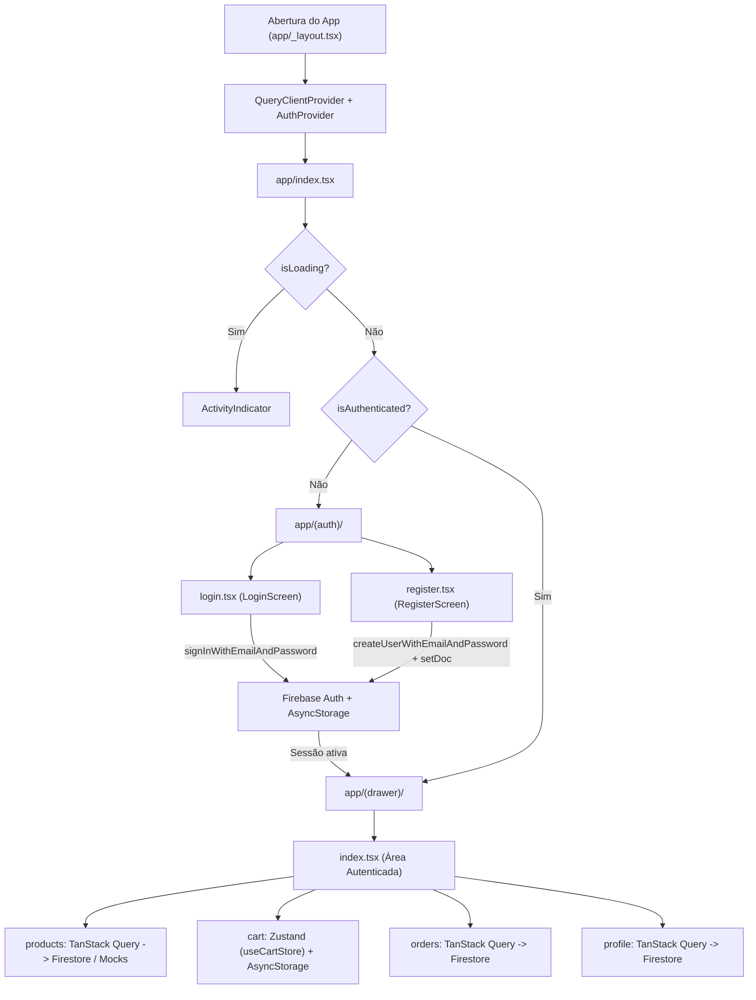
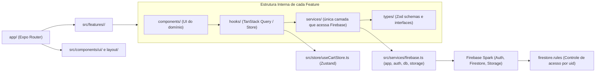

# ShopGo Mobile

Aplicativo mobile de marketplace construído com **React Native**, **Expo (SDK 58)**, **Expo Router** e **Firebase (Plano Spark)** seguindo a **Feature-Based Architecture**.

---

## Download do APK (Android)

Baixe a versão mais recente do aplicativo diretamente na página de Releases:

- [Download do APK (GitHub Releases)](https://github.com/EnzoYuri1/ShopeGo-FrontEnd-Mobile/releases/latest)

Após instalar o APK uma única vez no celular, novas atualizações de telas e código JS/TS são recebidas automaticamente via **EAS Update (OTA)** ao fechar e reabrir o aplicativo.

---

## Stack Tecnológica

- **Framework:** React Native + Expo + Expo Router (roteamento baseado em arquivos em `app/`)
- **Linguagem:** TypeScript (`strict: true`, alias `@/*` mapeado para `src/*`)
- **Backend as a Service (BaaS):** Firebase (`firebase/app`, `firebase/auth`, `firebase/firestore`, `firebase/storage`) com persistência de sessão via `@react-native-async-storage/async-storage`
- **Estado Remoto e Cache:** TanStack Query (`@tanstack/react-query`)
- **Estado Local e UI:** Zustand (`src/store/`)
- **Validação e Schemas:** Zod

---

## Pré-requisitos

- **Node.js** >= 22.13
- **npm**
- Aplicativo **Expo Go** no celular (ou emulador Android/iOS)

---

## Instruções de Execução

1. **Instale as dependências:**

```bash
npm install
```

2. **Configure as variáveis de ambiente:**

Copie o arquivo de exemplo e preencha com as credenciais do projeto Firebase:

```bash
cp .env.example .env
```

Variáveis esperadas no `.env`:

```env
EXPO_PUBLIC_FIREBASE_API_KEY=...
EXPO_PUBLIC_FIREBASE_AUTH_DOMAIN=...
EXPO_PUBLIC_FIREBASE_PROJECT_ID=...
EXPO_PUBLIC_FIREBASE_STORAGE_BUCKET=...
EXPO_PUBLIC_FIREBASE_MESSAGING_SENDER_ID=...
EXPO_PUBLIC_FIREBASE_APP_ID=...
EXPO_PUBLIC_USE_MOCKS=true
```

> Com `EXPO_PUBLIC_USE_MOCKS=true`, o módulo de produtos utiliza os dados de `src/mocks/products.ts` como fallback local. Altere para `false` para consultar apenas o Cloud Firestore.

3. **Inicie o servidor de desenvolvimento:**

```bash
npx expo start
```

Escaneie o QR Code com o Expo Go (celular e computador na mesma rede Wi-Fi) ou use:

```bash
npx expo start --tunnel   # quando estiver em redes diferentes
npm run web               # abre no navegador
npm run android           # abre no emulador Android
npm run ios               # abre no simulador iOS
```

4. **Verificações de qualidade:**

```bash
npm run typecheck         # verificação estrita de tipos (tsc --noEmit)
npm run lint              # análise estática (expo lint)
npm run format            # formatação com Prettier
```

---

## CI/CD e Atualizações OTA

O projeto conta com pipeline automatizada em `.github/workflows/ci-cd.yml` (GitHub Actions) integrada ao **Expo EAS Update**:

- **CI (Pull Requests e push na `main`):** executa `npm ci`, `npm run typecheck` e `npm run lint`.
- **CD (push/merge na `main` ou disparo manual):** publica automaticamente uma atualização OTA no canal `preview` (`eas update --branch preview --environment preview`), atualizando o APK já instalado nos celulares sem necessidade de novo build.
- **Requisito no repositório:** secret `EXPO_TOKEN` configurado em *Settings -> Secrets and variables -> Actions* (as variáveis `EXPO_PUBLIC_FIREBASE_*` ficam gerenciadas no ambiente `preview` do EAS).

---

## Fluxo do Aplicativo



---

## Arquitetura (Feature-Based)

Toda comunicação com o Firebase é isolada na camada `services/` de cada feature, consumida pelas telas exclusivamente via `hooks/` (TanStack Query ou Zustand) e validada com schemas **Zod** em `types/`.



### Estrutura de Pastas

```text
ShopeGo-FrontEnd-Mobile/
├── .github/workflows/
│   └── ci-cd.yml                 # Pipeline de CI (typecheck/lint) e CD (EAS Update OTA)
├── app/                          # Rotas Expo Router (arquivos finos de navegação)
│   ├── (auth)/                   # Fluxo público: login e cadastro
│   ├── (drawer)/                 # Fluxo autenticado principal
│   ├── checkout/                 # Fluxo de pagamento
│   ├── product/                  # Detalhes do produto
│   ├── tracking/                 # Rastreamento de pedidos
│   ├── _layout.tsx               # Providers globais (QueryClientProvider, AuthProvider)
│   └── index.tsx                 # Redirecionamento inicial conforme estado de auth
├── src/
│   ├── components/               # Componentes globais reutilizáveis (ui/ e layout/)
│   ├── constants/                # Design tokens, cores, espaçamentos, strings e config
│   ├── features/                 # Módulos isolados por domínio
│   │   ├── auth/                 # components/, hooks/, providers/, services/, types/, utils/
│   │   ├── cart/                 # components/, hooks/, services/, types/
│   │   ├── orders/               # components/, hooks/, services/, types/
│   │   ├── products/             # components/, hooks/, services/, types/
│   │   └── profile/              # components/, hooks/, services/, types/
│   ├── hooks/                    # Hooks genéricos globais
│   ├── mocks/                    # Dados fictícios para fallback local
│   ├── services/
│   │   └── firebase.ts           # Singleton do Firebase SDK
│   ├── store/                    # Estado global local com Zustand (useCartStore.ts)
│   ├── types/                    # Tipagens globais compartilhadas
│   └── utils/                    # Funções utilitárias puras
├── .env.example                  # Modelo das variáveis EXPO_PUBLIC_FIREBASE_*
├── eas.json                      # Perfis do EAS Build e canais do EAS Update
└── firestore.rules               # Regras de segurança do Cloud Firestore
```
